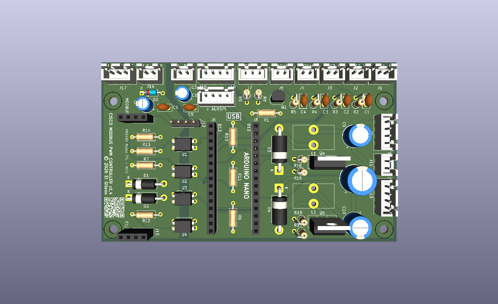

# CISCO AA23200 (3000W) PWM & Modbus RTU Controller

A galvanically isolated **Modbus RTU**, **31 kHz Buck-PWM Fan Controller**, **4-Channel NTC Temperature Monitor**, and **I²C Telemetry Interface** designed to retrofit **Cisco / Astec AA23200 3000W Server PSUs** for CNC machines, lab power supplies, and industrial control cabinets. 

This project was heavily inspired by this thread: https://forum.mosfetkiller.de/viewtopic.php?t=64061 and developed with AI assistance.



---

## Features

- **Cisco ADM1041 I²C Telemetry Bridge (`CN940`):**
  - Direct connection to the PSU's internal `ADM1041` controller (`SDA`, `SCL`, `SGND`) for reading PSU status, voltages, currents, and fault flags. As well as writing Voltages from 41.1V to approx. 51V via registers in temporary RAM
- **2× High-Current 31 kHz Buck-PWM Fan Channels (`FAN1`, `FAN2`):**
  - Driven by logic-level `IRLZ44N` N-MOSFETs (`Q4`, `Q5`) with `47 µH` toroidal inductors (`L1`, `L2`), `SB340` Schottky freewheeling diodes (`D3`, `D4`), and `220 µF` low-ESR output capacitors (`C9`, `C10`) for smooth DC-like voltage control of high-power server fans (up to 3 A+ per channel) without PWM whine.
- **Galvanically Isolated RS485 / Modbus RTU & E-Stop:**
  - Full galvanic isolation (`~2.5 mm` creepage/clearance trench) between PSU logic (`GND` / `+5V`) and external control cabinet bus (`/ISO_GND` / `/ISO_5V`) via a `B0505S-1WR3` isolated DC/DC converter (`J12`) and 4× `PC817` optocouplers (`U1`–`U4`).
  - Bidirectional TVS diode transient protection (`P6KE6.8CA`, `D1`/`D2`) on RS485 `A`/`B` lines and `1N4148` clamping (`D5`) on the isolated E-Stop input.
- **4× NTC Thermistor Inputs (`NTC1`–`NTC4`):**
  - `10 kΩ` (1%) precision voltage dividers (`R2`–`R5`) with `100 nF` hardware low-pass filtering (`C1`–`C4`) on `A0`–`A3`.
- **Open-Drain Tacho Output (`D2` / `Q1`):**
  - `2N7000` open-drain driver (`Q1`) to feed a simulated fan tachometer signal (`~200 Hz`) back to the Cisco mainboard so the green **FAN OK** LED stays active after replacing the stock fan. 
- **Expansion Headers:**
  - `AUX_IN` (`A6`, `A7` with `1 kΩ` series protection) and `AUX_SPI` (`MOSI`, `MISO`, `SCK`, `+5V`) for external displays, sensors, or additional I/O.

---

## Repository Structure

```text
├── Hardware/          # KiCad 10 project (.kicad_sch, .kicad_pcb), Gerbers, BOM & FreeCAD 3D carrier
├── Software/          # Arduino Nano firmware (31 kHz PWM, NTC Steinhart-Hart, Modbus RTU, ADM1041 I2C)
├── media/             # pictures and documentation
└── README.md          # Project documentation & pinout reference
```

---

## Hardware Pinout & Connectors (PCB v1.4)

All board connectors use **2.50 mm JST-XH** headers unless noted otherwise.

### Power & Fan Outputs (Top Edge)

| Connector | Label | Pin 1 | Pin 2 | Pin 3 | Pin 4 | Notes |
| :--- | :--- | :--- | :--- | :--- | :--- | :--- |
| **`J9`** | `-  +  T  FAN1` | `FAN1-` (Buck GND) | `+12V` | `D2` (Tacho) | `D6` | Channel 1 Buck-PWM (`D9` -> `Q4`) |
| **`J11`** | `-12V+` | `GND` | `+12V` | — | — | Main 12 V supply from Cisco PSU |
| **`J10`** | `-  +  T  FAN2` | `FAN2-` (Buck GND) | `+12V` | `D7` | `D8` | Channel 2 Buck-PWM (`D10` -> `Q5`) |

### Sensors, Telemetry & Isolated Field Bus (Left Edge)

| Connector | Label | Pin 1 | Pin 2 | Pin 3 | Pin 4 | Notes |
| :--- | :--- | :--- | :--- | :--- | :--- | :--- |
| **`J1`** | `NTC1` | `A1` | `GND` | — | — | 10 kΩ NTC input (`R3`, `C2`) |
| **`J2`** | `NTC2` | `A2` | `GND` | — | — | 10 kΩ NTC input (`R4`, `C3`) |
| **`J3`** | `NTC3` | `A0` | `GND` | — | — | 10 kΩ NTC input (`R2`, `C1`) |
| **`J4`** | `NTC4` | `A3` | `GND` | — | — | 10 kΩ NTC input (`R5`, `C4`) |
| **`J5`** | `TACHO` | `Q1 Drain` (`D2`) | `NC` | — | — | Open-drain tacho signal to Cisco |
| **`J7`** | `- CN940-I2C` | `GND` (`SGND`) | `SCL` (`A5`) | `SDA` (`A4`) | — | Connects to Cisco `CN940` header |
| **`J18`** | `+ AUXIN -` | `+5V` | `A6` (1 kΩ) | `A7` (1 kΩ) | `GND` | Auxiliary analog inputs |
| **`J13`** | `- 5V +` | `GND` | `+5V` | — | — | 5 V standby supply from Cisco PSU |
| **`J14`** | `- E-STOP` | `/ISO_GND` | `/ISO_ESTOP` | — | — | **Isolated** E-Stop loop (`U4` -> `D5`) |
| **`J17`** | `- RS485` | `/ISO_GND` | `RS485 B` | `RS485 A` | — | **Isolated** Modbus RTU bus (`TVS` protected) |

### Internal Headers

| Connector | Label | Pin 1 | Pin 2 | Pin 3 | Pin 4 | Notes |
| :--- | :--- | :--- | :--- | :--- | :--- | :--- |
| **`J19`** | `+ AUXSPI` | `+5V` | `MOSI` (`D11`) | `MISO` (`D12`) | `SCK` (`D13`) | Auxiliary SPI expansion |
| **`J12`** | `B0505S-1WR3` | `GND` | `+5V` | `/ISO_GND` | `/ISO_5V` | Isolated 5 V DC/DC converter |
| **`J6`/`J8`** | `ARDUINO NANO` | — | — | — | — | `15.24 mm` (600 mil) row spacing |
| **`J15`/`J16`** | `MAX485` | — | — | — | — | `40.64 mm` (1600 mil) row spacing |

---

## Cisco AA23200 Internal `CN940` I²C Wiring

The `CN940` connector on the Cisco AA23200 daughterboard is a 3-pin `2.50 mm` SMD shrouded header located near the rear bezel cutout:

```text
CN940 (looking into header, Pin 1 marked with white dot on the right):
[ Pin 3: SGND ]  [ Pin 2: SCL ]  [ Pin 1 (•): SDA ]
       │                │                 │
       ▼                ▼                 ▼
   J7 Pin 1         J7 Pin 2          J7 Pin 3
```

> **Tip:** Because `CN940` is an SMD header with narrow side slots, use individual heat-shrink-insulated `JST-XH` female crimp contacts secured with a small drop of hot glue / RTV silicone rather than forcing a standard `JST-XH` housing.

---

## Mechanical Integration

- **PCB Dimensions:** `64.92 mm × 106.68 mm` (2-layer FR-4, `1.6 mm`, `1 oz` copper)
- **Mounting Holes:** 4× `M3` (`Ø 3.2 mm`), spacing `46.46 mm × 98.00 mm`
- **Orientation:** Mounted horizontally (`90°` rotated) along the inner side wall via a custom **PETG/ASA 3D-printed carrier bracket** (`Hardware/`), maintaining generous clearance to the overhead 320–400 V PFC choke and separating the main backplane wiring harness from the JST connectors.

---

## Safety Notice

⚠️ **High Voltage Warning:** Opening a server power supply exposes mains voltage (`230 V AC`) and high-voltage DC bus capacitors (`320–400 V DC`). Always disconnect mains power, allow capacitors to discharge fully before working inside the chassis, and maintain adequate insulation barriers between the controller board and primary-side components.

---

## License

© 2026 El Gitano — Released for personal and open-source hardware use.
